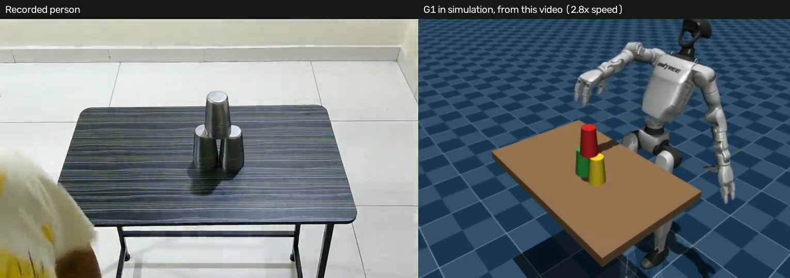
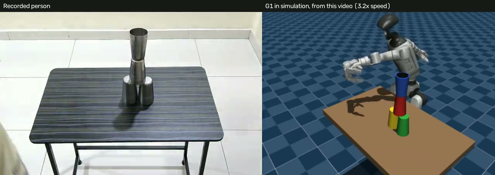

# Video2Robot

I film myself stacking steel glasses at a table. A simulated Unitree G1 watches the footage, works out which glass moved where and in what order, and repeats the task in MuJoCo.



| Task | From my video | Video |
|---|---|---|
| **Task 2:** three glasses into a triangle | Order and positions come from the video, and the robot builds it | [Side by side](docs/videos/task2_video_to_robot.mp4) |
| **Task 3:** a fourth glass flipped and stood on top, opening up | Order, positions and the flip come from the video, and the layout also picks **which arm works and where the robot stands** | [Side by side](docs/videos/task3_video_to_robot.mp4) |



## How my recording drives the robot

```
phone video of steel glasses, no marker
  -> table corners and measured table size: pixels to real centimetres
  -> bright closed glass tops: where each glass rests, and when it leaves
  -> pair each spot left with the next new spot: the moves, in order
  -> dark top on the finished tower: the last glass was flipped
  -> tower's side of the glasses: which arm works, and where the robot stands
  -> G1 repeats it in physics, gripping by friction
  -> check where the glasses really ended up
```

Without the recording, the robot has no starting positions, no tower position, no order, no arm and no standing spot. The robot's grip and flip are programmed, and they aren't learned from my hand. So it copies **what happened and where**, not how my hand moved.

## Design choices

| Choice | Why |
|---|---|
| Copy what happens to objects, not the hand | A human hand and the G1's three-finger hand differ, so the outcome is what transfers. This idea comes from Robot See Robot Do |
| Identical steel glasses | Colour tracking can't tell them apart, so a glass is identified by where it rests. The order survives, with no labels and no large vision model |
| The table as the ruler, no marker | Its four corners and measured size (80 x 50 cm) give real distances and the camera's position, with nothing printed |
| Correct for height | A glass top is 11.5 cm above the table, and a stacked one 23 cm. Without this, positions come out several centimetres wrong |
| Task 2 uses the nearest arm | Glasses and tower on the robot's left suit its left arm far better: 24 of 30 against 10 of 30 |
| Let the layout choose the arm and standing spot | The flip only works towards the arm's own side. My video had the tower on the robot's left, which the right arm can't do, so the left arm mirrors the right arm's settings and no glass has to move |
| Refuse rather than guess | If a video doesn't read as a clear task, the system says so and stops |
| Report every compromise | The arm and standing spot go in each report, and any glass moved to fit is listed in cm |

## Results

Everything runs in MuJoCo with a **pinned pelvis**. The simulated glass matches my measured size (11.5 cm tall, 7.3 cm rim, 5.5 cm closed end), but it is solid and rigid, and its weight is a guess.

### From my real videos

| Video | Reading | Robot |
|---|---|---|
| `task2_triangle_right_take1` | 3 of 3 moves in order | **Built the triangle**, tower 0.2 cm from where the video put it |
| `task3_flip_right_take1` | 4 of 4 moves in order, flip recognised | **Built and flipped with no glass moved.** Left arm, robot standing 23.4 cm right of the table's middle. Tower 0.5 cm from where the video put it |
| The same video, robot kept mid-table with its right arm | As above | **Failed:** dropped the fourth glass in the twist |
| `task2_triangle_take2`, glasses on both sides | 3 of 3 moves. **Top glass not seen, worked out from the others** | **Built the triangle** with the left arm, tower 0.4 cm off |
| `task2_triangle_take5`, glasses on my left | As above | **Built the triangle** with the left arm, tower 0.5 cm off |
| `task2_triangle_check`, glasses on my left | 3 of 3 moves | **Failed:** the hand knocked a glass while reaching for a far one, 37 cm from my edge |
| `task2_triangle_take6`, glasses on both sides | 3 of 3 moves | **Failed:** glasses knocked or tilted. The same layout also failed all 12 simulator runs, including a changed order and one glass moved closer. **With `--two-arms`, it built the triangle,** tower 0.2 cm off |
| `task2_triangle_take3`, `take4`, `take7`, `take8` | **Refused:** a starting glass was missed | Not run |
| `task2_triangle_left_take1`, my first video | **Refused:** 8 spots found, 6 expected | Not run. An earlier version read it, and the robot couldn't reach a glass on its far left |
| `task3_flip_left_take1` | **Refused:** the order didn't make sense | Not run |

**Eight later Task 2 takes.** With the reader as it stood, 2 of the 8 could be read and the robot failed both, so **0 of 8 succeeded**. It missed dull glass tops, and tops against the bright floor. I then added one rule: if all three starts were left and two glasses end side by side, the third must be on top. That made 4 of 8 readable and **2 of 8 succeed**, shown in `docs/videos/task2_left_arm_video_to_robot.mp4`. I wrote that rule after seeing these videos, so they aren't a fair test of it. Gentler brightness limits made reading worse, so I dropped them.

**Two arms, Task 2 only.** With `--two-arms`, each glass uses the arm on its own side, and the arms take turns, going around the glasses. It's optional and off by default.

| Test | Two arms | One arm (nearest) |
|---|---|---|
| 30 random layouts across both sides, the set I used to find a handover bug | 20 of 30 | 20 of 30 |
| 30 new random layouts across both sides | 22 of 30 | 21 of 30 |
| `task2_triangle_take6` layout, exact and nudged | 5 of 6 | 0 of 6 |
| `task2_triangle_take4` layout, exact and nudged | 5 of 6 | 2 of 6 |

**On random layouts it's a tie.** I picked those two real layouts because one arm struggled there, which flatters two arms, so this doesn't show it's better in general. Most remaining failures are tilted glasses, which swapping arms doesn't fix. From the real video, `task2_triangle_take6` **built the triangle** with two arms, tower 0.2 cm off, where one arm fails. See `docs/videos/task2_two_arms_video_to_robot.mp4`.

**Copying my hand's path, Task 2 only.** With `--hand-path`, a hand tracker (MediaPipe) follows my hand, and the robot carries each glass with my hand's height and timing, at its own safe speed. This is a first step towards retargeting, and nothing is trained. The grip, levelling, aiming and release stay programmed, and finger poses aren't copied.

One camera can't judge depth, so I assume the hand moves in the upright plane between each glass's start and end. So only height and progress along the way are copied, not any sideways curve. Heights are limited to 20-38 cm so the glass clears others.

| Video | Result with `--hand-path` | Tower off |
|---|---|---|
| `task2_triangle_right_take1` | **Built the triangle** | 0.6 cm |
| `task2_triangle_take2` | **Built the triangle.** One carry went straight towards the camera, so its depth wasn't believable and it used the programmed carry | 0.3 cm |
| `task2_triangle_take5` | **Built the triangle** | 0.4 cm |
| `task2_triangle_take6`, with `--two-arms` | **Built the triangle** | 0.6 cm |

**An indirect check, with no tuning.** My hand holds a glass near its middle. The estimate says about 5-8 cm when holding a glass on the table (its middle is 5.75 cm up), and about 14-19 cm when placing the top glass (its middle is 17 cm up). I have no ruler measurements of the hand itself. These four videos were also used to write the method, so they aren't a fair test. See `docs/videos/task2_hand_path_video_to_robot.mp4`.

**What goes wrong when the tower is far to one side, Task 2.** In 60 random layouts with two arms, towers within 12 cm of the table's middle passed 34 of 35, and those further out passed 8 of 25 (one arm: 27 of 35, and 14 of 25). I chose the 12 cm line after seeing results. Replaying the 25 far towers showed why: when an arm reached across the body to the far side, its hand stopped short in 25 of 46 placements, against 1 of 25 for the arm on the tower's side. My own towers were all within about 7 cm of the middle. Task 3 doesn't show this, because the robot stands somewhere different for each layout.

**Six later Task 3 takes, the fair test.** I recorded these in deliberately different layouts, and ran them with nothing changed. **None of the 6 succeeded:**

| Video | Glasses | Reading | Robot |
|---|---|---|---|
| `task3_flip_take2` | Grouped on my left | Read | **Failed:** knocked glasses that stood close together, so the triangle failed |
| `task3_flip_take3` | Three on my left, one on my right | Read | **Failed:** couldn't grip the fourth glass, far across the table |
| `task3_flip_take7` | Spread on both sides | Read | **Failed:** the arm couldn't reach, so the triangle failed |
| `task3_flip_take4` | Spread on both sides | **Refused:** 8 spots found, 7 expected | Not run |
| `task3_flip_take5` | Three on my right, one on my left | **Refused:** missed a starting glass, and saw the top glass twice | Not run |
| `task3_flip_take6` | Spread on both sides | **Refused:** missed a starting glass | Not run |

**Two more takes, in a layout I chose to suit the robot:**

| Video | Reading | Robot |
|---|---|---|
| `task3_flip_take8` | **Refused:** the top glass was barely seen | Not run. In simulator runs at the positions read, the robot failed to grip the glass to flip all 6 times, because it was about 39 cm from my edge |
| `task3_flip_take9` | 4 of 4 moves in order, flip recognised | **Built and flipped with no glass moved.** Left arm, robot standing 24.4 cm right of the table's middle. Tower 0.4 cm off. See `docs/videos/task3_new_video_to_robot.mp4` |

Take 9 is the first Task 3 success on a video nothing was tuned on, but it's one run of a chosen layout. With its positions nudged by up to 1.5 cm in the simulator, only 3 of 6 runs passed, so that layout is fragile.

So Task 3 doesn't yet handle layouts it wasn't set up for. It uses one arm from one standing spot, which can't serve glasses spread across the table. Updating the table's corners afterwards didn't change which videos passed or failed, for these 6 or the 8 Task 2 takes.

**How far to trust this.** Each success is one run of one video, and I set the reading's settings while looking at these same videos. I also came up with the arm and standing-spot idea from the Task 3 video's own layout. Neither has been tested on a take kept apart from tuning. The robot doesn't walk to its standing spot: the simulation simply starts it there.

### Checks on the reading

I have no ground-truth ruler measurements for the glass positions, so these are indirect:

| Check | Result |
|---|---|
| The two lower glasses touch, so their tops should be about one rim width apart (7.3 cm) | 7.9 cm and 8.2 cm |
| The top glass should sit midway between the lower two | 0.2 cm and 0.7 cm off |
| The table's corners, fitted back into the picture | About 1 pixel on the first two videos. After the camera moved and I updated the rough corners, 0.75 to 4.3 pixels on the later takes I checked |
| Hand-picked rough corners moved by up to 20 pixels, 25 tries each | Positions change by 0.11 cm at most |
| Flip check at the tower's top | Correct for both right-side videos: dark opening in Task 3, none in Task 2 |

### What the robot can physically do

These tests use simulator positions and a hand-written plan, so they don't involve video. Each one is a full task from random spots. The areas were narrowed using earlier failures, then retested on fresh random setups.

| Task | Setups | Result |
|---|---|---|
| Triangle, across the table's right side | Glasses 12-34 cm from the edge, centre to 30 cm right. Tower middle 24-36 cm from the edge, 12 cm left to 24 cm right | **28 of 30** |
| Flipped tower, robot mid-table, right arm | Glasses 13-19 cm from the edge, 14 cm left to 10 cm right. Glass to flip 23-28 cm from the edge, 4 cm left to 10 cm right. Tower middle 20-27 cm from the edge, 26-31 cm right | **28 of 30** |

Letting Task 2 choose the nearest arm, compared on identical layouts:

| Layouts | Nearest arm | Right arm only |
|---|---|---|
| Glasses 12-34 cm from the edge, up to 36 cm left. Tower middle 24-36 cm from the edge, 12 cm right to 24 cm left | **24 of 30** | 10 of 30 |
| Glasses and tower spread across both sides | 20 of 30 | 21 of 30 |

So it helps when everything is on one side, and doesn't when the layout is spread across both. The robot keeps one arm for the whole task, and doesn't swap arms between glasses. On my Task 2 video it picks the right arm.

Letting Task 3 choose its arm and standing spot, with no glass moved:

| Test | Setups | Result |
|---|---|---|
| Task 3 video's layout, wobbled by up to 1.5 cm | Left arm | **19 of 21** |
| Random layouts along the whole table, first try | Glasses and glass to flip 13-33 cm from the edge | 12 of 30 |
| The same, with the glass to flip 23-33 cm from the edge | New random layouts. Tower middle 20-27 cm from the edge, 18-40 cm to either side of the glasses' middle | **25 of 30** (left arm 13 of 17, right arm 12 of 13) |

Run these with `scripts/area_test.py` and `scripts/stand_test.py`. Raw results and earlier area tests are in `docs/results/`. Pictures of the areas are in `docs/recording_views/`.

## What worked and what didn't

**Worked:**
- Following identical steel glasses by their bright tops, including recovering the order.
- Using the table in place of a printed marker.
- Gripping by friction alone, with no shortcut attaching the glass to the hand.

**Didn't work, or needed fixing:**
- **Real glasses broke the robot's motion, 0 of 6.** A motion that passed 30 of 30 with smaller cups failed with my taller glass. It needed a higher grip, levelling, measured aiming, and a higher lift, because the hand was knocking over the finished tower on its way back.
- **One arm can't flip anywhere.** Across its chest, the right arm hits the robot's own body. Flipping elsewhere and carrying the glass across made the arm swing and destroy the tower, so I removed that. Moving the glasses to fit worked, by up to 33 cm, but copied my layout badly. Choosing the arm and standing spot replaced it.
- **Hand tracking wasn't useful for timing.** It found the hand in 93-96% of frames, but picked 13 moments for 6 real ones and 17 for 8. The system uses glass rest spots instead.
- **Colour tracking and the marker were built first, then dropped for the real task.** My glasses are steel, and I recorded without a marker.
- **Grip retries didn't help.** Rerunning the failed setups with up to three grip attempts rescued none of them, so I removed the retries. The working fix was keeping glasses 15 cm from the tower.
- **My table estimate exposed a measuring error.** I was first told 80 x 60 cm, and the video said otherwise. The real size was 80 x 50.

## Limitations

- **Pinned pelvis:** no balance, and reach is limited.
- **Three-finger Dex3 hand,** not a five-finger hand.
- **Programmed motion:** no learned policy, and no retargeting of my hand's motion.
- **The standing spot is set, not walked to,** and the glass to flip must start 23 cm or more from the table's near edge. Closer in, most runs failed to grip it.
- **Simulator knowledge:** once a run starts, the robot uses exact glass positions from the simulator, not from its own camera.
- **Hand-picked corners:** someone picks four rough table corners once per camera position, in `data/labels/`. A fit to each video's table edges then sharpens them.
- **Narrow conditions:** a fixed camera, a dark table, bright closed tops and fairly bright light. The settings suit my setup and would probably need changing elsewhere.
- **Flip check:** tested only on my two right-side videos.

## Running it

```bash
scripts/setup.sh
.venv/bin/pytest

# A sample video, through to the robot. Output goes to data/processed/
PYTHONPATH=. .venv/bin/python scripts/glass_from_video.py --video data/raw/sample/task2_triangle_right_take1.mp4
PYTHONPATH=. .venv/bin/python scripts/glass_from_video.py --video data/raw/sample/task3_flip_right_take1.mp4

# Put the person and robot side by side, after running the matching line above
PYTHONPATH=. .venv/bin/python scripts/side_by_side.py --video data/raw/sample/task2_triangle_right_take1.mp4

# Optional for a triangle: each arm serves its own side
PYTHONPATH=. .venv/bin/python scripts/glass_from_video.py --video data/raw/sample/task2_triangle_take6.mp4 --two-arms

# Optional for a triangle: carry each glass along the hand's path in the video
PYTHONPATH=. .venv/bin/python scripts/glass_from_video.py --video data/raw/sample/task2_triangle_take5.mp4 --hand-path

# Test what the robot can do, with random setups
PYTHONPATH=. .venv/bin/python scripts/area_test.py triangle --trials 30 --seed 8123
PYTHONPATH=. .venv/bin/python scripts/area_test.py flip --trials 30 --seed 9101
PYTHONPATH=. .venv/bin/python scripts/area_test.py triangle --spread left --arm nearest --trials 30 --seed 8600
PYTHONPATH=. .venv/bin/python scripts/stand_test.py video --trials 21 --seed 7100
PYTHONPATH=. .venv/bin/python scripts/stand_test.py wide --trials 30 --seed 7300
```

It runs on a laptop CPU, and was developed on an M1 Mac with 8 GB of RAM. A robot run takes a few minutes.

## Data

Samples are in `data/raw/sample/`, with the collection note in [`docs/DATA_COLLECTION.md`](docs/DATA_COLLECTION.md). The samples are compressed, at full size, to keep the repo small. They read within 0.1 cm of the originals.

## Earlier work in this repo

Before recording the steel glasses, I built a marker-and-colour pipeline for sorting blocks into trays. It's still here and tested on rendered video and in simulation (20 of 20 new setups, with a retry loop), but I never ran it on real footage, because I didn't have the blocks. `notes.md` explains the whole project from scratch.

## Credits

Built on MuJoCo, MuJoCo Menagerie, mink, MediaPipe and OpenCV. Ideas from SeeDo (VLM See, Robot Do) and Robot See Robot Do. Built with help from Claude Code.
