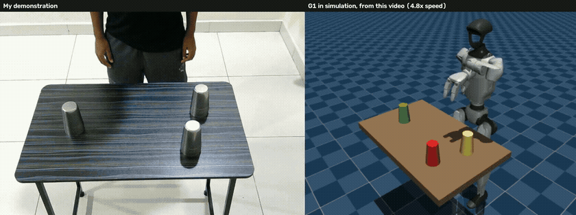
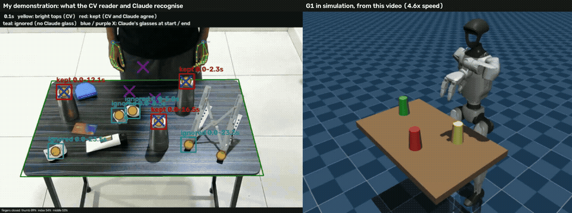
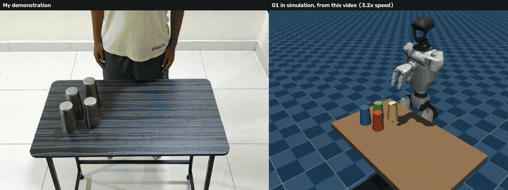
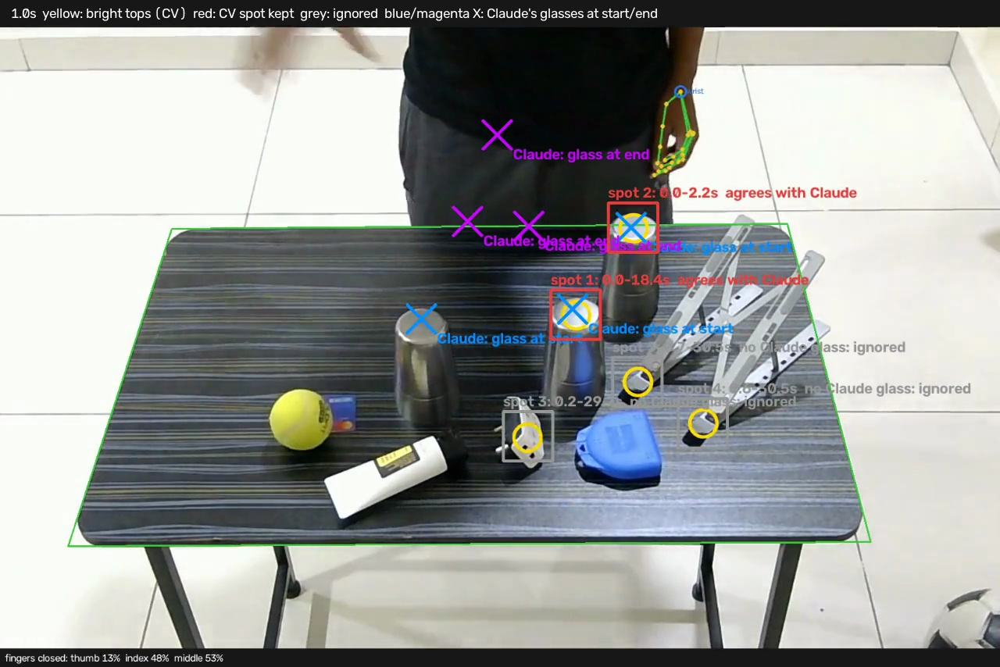
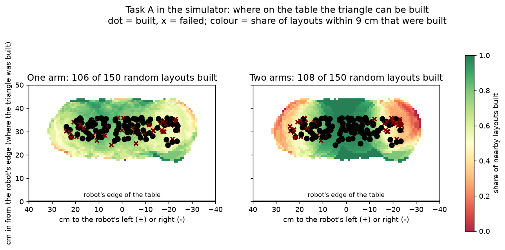

# 🤖 Video2Robot: a Unitree G1 repeats glass stacking from my webcam videos

[](https://www.python.org/downloads/)
[](https://mujoco.org/)
[-lightgrey.svg)](https://github.com/google-deepmind/mujoco_menagerie/tree/main/unitree_g1)
[](tests/)

> I film myself stacking steel glasses at a table. A simulated Unitree G1 humanoid watches the footage, works out which glass moved where and in what order, and repeats the task in MuJoCo. It uses no printed marker and no hand-written labels.

[](docs/videos/task2_take11_vs_robot.mp4)

*Task A, take 11, the whole video: my demonstration on the left, the G1 in MuJoCo on the right. Recorded after every fix and not tuned on; the robot used two arms and built the triangle 0.2 cm from where I did. [Full-quality video](docs/videos/task2_take11_vs_robot.mp4).*

[](docs/videos/annotated_demo_vs_robot.mp4)

*Task A on a cluttered table. Left: my video, marked with what each reader recognises. **Yellow** discs are shiny tops the CV reader finds, **red** boxes are kept because the CV reader and Claude agree, **teal** boxes are ignored because Claude sees no glass there (a charger, an earbud case, a plug), and **blue / purple** crosses are Claude's glasses at the start / end. Right: the G1 builds the same triangle in MuJoCo. [Full-quality video](docs/videos/annotated_demo_vs_robot.mp4).*

[](docs/videos/task3_flip_take1_vs_robot.mp4)

*Task B, take 1, the whole video: I build the triangle, then turn a fourth glass over and stand it on top. The G1 repeats it in MuJoCo, including the flip. [Full-quality video](docs/videos/task3_flip_take1_vs_robot.mp4).*

**▶️ More: [the real-world reel](docs/videos/reel_real_world.mp4)** (about 3.5 min: cluttered tables, an unused glass, a glass the right way up, and a moving plug) and [the original demo reel](docs/videos/demo_reel.mp4).

---

## 📖 Table of Contents
- [Overview](#-overview)
- [Key Features](#-key-features)
- [System Architecture](#️-system-architecture)
- [Repository Structure](#-repository-structure)
- [Installation](#-installation)
- [Data: recording your own videos](#-data-recording-your-own-videos)
- [Usage Guide](#-usage-guide)
  - [1. Video to robot](#1-video-to-robot)
  - [2. Optional helpers](#2-optional-helpers)
  - [3. Evaluation](#3-evaluation)
- [Configuration](#️-configuration)
- [Results & Benchmarks](#-results--benchmarks)
- [How it got here](#-how-it-got-here-one-idea-at-a-time)
- [Limitations](#️-limitations)
- [Contributing](#-contributing)
- [License](#-license)
- [Acknowledgements](#-acknowledgements)

---

## 📖 Overview

**Video2Robot** turns one fixed-webcam video of a person into a robot doing the same task in simulation. It handles two tasks:

| Task | What the person does |
|---|---|
| **Task A** | Builds three identical steel glasses into a triangle: two side by side, one on top |
| **Task B** | Builds the triangle, then turns a fourth glass over and stands it on top, opening up |

File and video names still use the earlier numbering: `task2_…` files are Task A and `task3_…` files are Task B.

**What the video decides:**
- where each glass starts;
- the order of the moves;
- where the tower goes;
- whether a glass is flipped;
- which arm the robot uses, and where it stands.

**What's programmed:** the grip, the flip and the arm motion, by inverse kinematics.

**Only one small model is trained here:** a 16-weight logistic regression model that picks one arm or two. **No VLA, RL or ACT policy is used:** they need a GPU and robot demonstrations this project doesn't have ([`notes.md`](notes.md), chapter 21). Optional parts use models others trained: MediaPipe (hands) and Claude (finding glasses).

**The robot is simulated, with its pelvis pinned** (it can't fall, and it can't walk). Every result below says which numbers come from real videos and which from simulator layouts, and which are "not a fair test" (tuned on the same videos).

---

## ✨ Key Features

* **The table is the ruler.** Its four corners and measured size (80 × 50 cm) turn pixels into real centimetres and give the camera's position, with no printed marker.
* **Identical glasses, told apart by where they rest.** Bright closed tops are followed frame by frame, which keeps the order of moves with no labels.
* **Claude reads the first and last frames** (optional, about 2 cents a video). It names which bright things are glasses, ignores clutter, and finds dull glasses the shiny-top reader misses. The free frame-by-frame reader still times the moves.
* **Extra glasses don't confuse it.** In a three-glass video with a fourth glass on the table that I never touched, the unused glass is recognised and left where it is, and the triangle is built from the other three. A glass standing the right way up (opening up), next to the three upside-down ones, is told apart the same way. Both were fresh videos that were first refused, then fixed with one rule each.
* **The robot chooses its arm and standing spot** from the layout. A logistic regression model picks one arm or two before the robot moves.
* **Step checks** after every reach, grip, lift, carry, place and release, so a failed run says *where* it failed.
* **Honest reporting:** every idea is logged with its test and its before-and-after numbers in [`docs/JOURNEY.md`](docs/JOURNEY.md), including the ones that were dropped.

---

## 🏗️ System Architecture

```
webcam video of steel glasses, no marker
  -> table corners and measured size: pixels to real centimetres, camera position
  -> Claude (optional): which things are glasses, at the start and at the end
  -> bright closed tops, frame by frame: when each glass leaves, and where it lands
  -> pair each start with its landing: the moves, in order; the top glass by position
  -> layout: which arm(s), and where the robot stands
  -> G1 repeats it in MuJoCo, gripping by friction (inverse kinematics with mink)
  -> step checks, then compare where the glasses ended with the video
```

| Job | Tool | Why |
|---|---|---|
| Which things are glasses (start and end) | Claude, one picture each | Recognises glasses, ignores clutter |
| *When* each glass moved | Frame-by-frame bright-top reader | Needs every frame; free |
| Pixels to centimetres | The table's corners | Exact geometry, no marker |
| Moving the robot | Inverse kinematics (mink) | Programmed, measured, repeatable |

### 🔍 Telling glasses from shiny clutter: the CV reader and Claude must agree

Steel glasses are shiny, and so are plugs, chargers and the feet of a laptop stand. The frame-by-frame CV reader looks for bright, round tops, so on its own it takes some of these for glasses and misses glasses whose tops are dim. Claude recognises glasses reliably but only looks at two pictures, the first and the last frame. So each one checks the other:



*One frame of [the annotated video](docs/videos/task2_clutter_take6_annotated.mp4). Yellow discs: bright tops the CV reader found. Blue and purple crosses: Claude's glasses in the first and last frames. Red: kept, because both agree. Teal: ignored, because Claude sees no glass there (a plug, a charger, an earbud case, a foot of the laptop stand).*

| CV reader | Claude | Decision |
|---|---|---|
| Sees a glass | Sees a glass at the same place | **Keep it**, at the CV reader's more exact position |
| Doesn't see it | Sees a glass | **Add it** at Claude's point |
| Sees a "glass" | Sees nothing there | **Ignore it** as clutter |
| Something lands mid-video | No glass there at the end | **Ignore it**, like a plug or earbud case moved aside |

The CV reader still decides **when** each glass moved, because that needs every frame. If its times are impossible (a glass landing before any glass left), the time a glass landed is taken from when the picture at Claude's end point started to look like the end. This happened when a charger was set down right where a glass later landed.

---

## 📁 Repository Structure

```text
├── configs/              # YAML settings: scene, motion, reader, Claude (all tunable numbers)
├── data/
│   ├── raw/sample/       # four sample videos (compressed copies of my recordings)
│   └── labels/           # four rough table corners per camera position
├── docs/                 # journey, results in detail, data collection, videos, result files
├── scripts/              # entry points: glass_from_video.py, comparisons, videos, area tests
├── src/
│   ├── perception/       # table view, glass reader, Claude rescue rules, hands
│   ├── reasoning/        # arm choice, standing spot, logistic regression model, Claude client
│   ├── simulation/       # G1 scene, inverse kinematics, pick, place, flip, arm swap
│   └── verification/     # triangle and flip checks, step checks
├── tests/                # 308 tests
├── notes.md              # the whole project explained from zero, as a book
├── PLAN.md               # phases and status
└── README.md             # this file
```

---

## 💻 Installation

Developed and run on an M1 Mac with 8 GB of RAM, on the CPU. No GPU is needed.

**1. Clone the repository:**
```bash
git clone https://github.com/ankamsriman/Video2Robot.git
cd Video2Robot
```

**2. Create the environment and download the G1 model and hand tracker:**
```bash
scripts/setup.sh          # .venv with the exact tested versions, MuJoCo Menagerie's G1, MediaPipe hands
.venv/bin/pytest          # 308 tests
```

**3. (Optional) Claude helper:** put your Anthropic API key in a `.env` file as `VIDEO2ROBOT_CLAUDE_KEY=...`. It has its own name so tools that load `.env` can't hand it to anything else. Git ignores `.env`.


---

## 📊 Data: recording your own videos

My videos were recorded with **one fixed webcam** (a Logitech Brio 100, 1620 × 1080 at 30 frames a second):
- about 97 cm above the table;
- looking down about 43°;
- from the side of the table opposite the person.

The code works this position out from the table's corners. **Four samples are in `data/raw/sample/`** (two cluttered Task A videos and two Task B videos), and the full note is in [`docs/DATA_COLLECTION.md`](docs/DATA_COLLECTION.md).

To record your own:
1. Keep all four table corners in view, and the camera still.
2. Stand the glasses upside down (closed end up).
3. Move one glass at a time, with a short pause between moves.
4. For a new camera position, add four rough corners in `data/labels/<video>_table.json`:
   ```json
   { "rough_corners": [[321, 361], [1295, 364], [1401, 786], [186, 834]] }
   ```
   The order is top-left, top-right, bottom-right, bottom-left, as seen in the picture. The code sharpens them by fitting the table's edges.

---

## 🚀 Usage Guide

### 1. Video to robot
```bash
# Task A: a triangle on a cluttered table. Claude tells the glasses from the clutter (needs the API key).
# The report and robot video go to data/processed/<video>/
PYTHONPATH=. .venv/bin/python scripts/glass_from_video.py --video data/raw/sample/task2_triangle_clutter_take5.mp4 --find-glasses --choose-arms

# Task B: the flipped tower
PYTHONPATH=. .venv/bin/python scripts/glass_from_video.py --video data/raw/sample/task3_flip_right_take1.mp4

# Your video beside the robot's, with the tracked hand drawn on
PYTHONPATH=. .venv/bin/python scripts/side_by_side.py --video data/raw/sample/task2_triangle_clutter_take5.mp4 --show-hand
```

### 2. Optional helpers
```bash
# A typed instruction, turned into a checked plan
PYTHONPATH=. .venv/bin/python scripts/glass_from_video.py --video data/raw/sample/task2_triangle_clutter_take5.mp4 --instruction "nearest glasses at the bottom, farthest on top"

# Each arm serves its own side; or copy the hand's carry height and timing
PYTHONPATH=. .venv/bin/python scripts/glass_from_video.py --video data/raw/sample/task2_triangle_clutter_take6.mp4 --find-glasses --two-arms
PYTHONPATH=. .venv/bin/python scripts/glass_from_video.py --video data/raw/sample/task2_triangle_clutter_take5.mp4 --find-glasses --hand-path

# See live, on the webcam, what the CV reader takes for glass tops (Q quits)
PYTHONPATH=. .venv/bin/python scripts/live_cv_reader.py

# Watch a run live in the MuJoCo window (Mac: mjpython)
PYTHONPATH=. .venv/bin/mjpython scripts/watch_video_live.py --video data/raw/<video>.mov --claude --choose-arms --slow 2
```

### 3. Evaluation
```bash
# What the robot can physically do, on random simulator layouts
PYTHONPATH=. .venv/bin/python scripts/area_test.py triangle --trials 30 --seed 8123
PYTHONPATH=. .venv/bin/python scripts/area_test.py flip --trials 30 --seed 9101

# Compare setups on real videos (setup letters, not task letters): A = Claude + model, B = Claude + an arm per glass, C = no Claude
PYTHONPATH=. .venv/bin/python scripts/compare_task2_setups.py --setups A C

# See why a video failed: what the CV reader saw, Claude's glasses, and which spots were kept or ignored
PYTHONPATH=. .venv/bin/python scripts/explain_reading.py --video data/raw/<video>.mov --claude
PYTHONPATH=. .venv/bin/python scripts/annotate_start_end.py --video data/raw/<video>.mov

# All tests, with coverage
.venv/bin/pytest --cov=src --cov-report=term-missing
```

---

## ⚙️ Configuration

All tunable numbers live in YAML files in `configs/`: `cups_real.yaml` for Task A and the video reader, `flip_real.yaml` for Task B. A snippet:

```yaml
vlm:
  model: claude-sonnet-5-5     # chosen after comparing Haiku, Sonnet and Opus
vlm_rescue:
  near_pixels: 30              # a Claude point and a reader spot this close are the same glass
  end_seconds: 0.5             # Claude also looks this long before the video ends
```

---

## 📈 Results & Benchmarks

**Real videos** (my webcam recordings; the robot is always simulated with its pelvis pinned). Results cover videos whose glasses lie within reach of a robot that can't walk:

| Task | Without AI | With Claude | Notes |
|---|:---:|:---:|---|
| **Task A**, my first 9 videos | 3 of 9 (4 with two arms) | **8 of 9** | Claude rescued 4 videos where the reader missed a glass. |
| **Task A**, 7 fresh hard videos (clutter, an unused glass, glints, a moving plug, sunlight) | not run | **0 of 7** on their fair first run → **6 of 7** after one rule per failure | Not a fair test after the fixes. Sunlight still fails: the tower was too close to the robot's chest |
| **Task A**, 26 videos within the robot's reach, final system | not run | **20 of 26** | Developed on many of them. **On fair tests only, 6 of 11.** Failures: triangles built too close to the robot's chest (2), glasses at the far corners, and very quick moves (3, all refused) |
| **Task B**, all 8 of my videos | 2 of 7 (first 7) | **2 of 8** | Most failures are glasses beyond a robot that can't walk |

**What the robot can do, with exact simulator positions:**

| Test | Result |
|---|:---:|
| Task A, 30 random layouts in its working area | **28 of 30** |
| Task B, 30 random layouts in its working area | **28 of 30** |
| Arm choice on 60 new layouts: always one arm / always two / hand rule / **logistic regression** / best possible (before the 5 Nov two-arm bias) | 43 / 44 / 49 / **50** / 51 |
| Claude finding glasses on 10 cluttered simulated tables | **10 of 10** |

**Robot videos:**
- [cluttered table](docs/videos/task2_clutter_video_to_robot.mp4)
- [moving plug](docs/videos/task2_hard_video_to_robot.mp4)
- [arm swap with an unused glass](docs/videos/task2_arm_swap_video_to_robot.mp4)
- [Task A](docs/videos/task2_video_to_robot.mp4)
- [Task B](docs/videos/task3_new_video_to_robot.mp4)

**📊 Analysis with charts: [`docs/ANALYSIS.md`](docs/ANALYSIS.md).** Where on the table the robot succeeds and fails (shaded maps, one arm against two), every real video grouped by result, what Claude and the logistic regression model each add, and what the failures have in common.

[](docs/ANALYSIS.md)

**Every result in detail**, with each video, each check and each comparison: [`docs/RESULTS_IN_DETAIL.md`](docs/RESULTS_IN_DETAIL.md).

---

## 🧭 How it got here, one idea at a time

Each idea came from counting the failures of the one before. The full record, about 60 ideas including the dropped ones, is in [`docs/JOURNEY.md`](docs/JOURNEY.md).

| Stage | Problem found in the failures | Idea that fixed it | Before → after |
|---|---|---|---|
| Robot skills | Silent "reached" when the hand was 21 cm short | Measure the real hand; judge where the object lands | 0 of 10 → **20 of 20** |
| The flip | Thrown, slipping and off-centre cups | Wrist-only twist, deeper grip, aim at the measured cup | 1 of 9 → **50 of 50** |
| Real glasses | Steel has no colour; no marker | Bright closed tops; the table's corners as the ruler | Unusable → moves read in order |
| Which arm | Left-side layouts failed with the right arm | Nearest arm; an arm per glass; a logistic regression model to choose | 10 → **24 of 30**; model 50 of 60 |
| Reading | Missed glasses refused videos | Claude names the glasses; measurements stay in charge | 4 → **8 of 9** |
| Fresh hard videos | Clutter, dull tops, an unused glass, glints, a hidden glass | Claude reads the first **and last** frames; one rule per failure | 0 of 7 → **6 of 7** |
| Arm swap | A swap twisted the body into the table; an idle hand rested on it | Hands rise and pass beside the body; the idle arm waits raised | 68 → **0** frames touching the table |
| Moving clutter | A charger set down where a glass later landed made a landing look 4 s early, and the video was refused | Only when the order is impossible, time each landing from when the picture at Claude's end point looked final | Refused → built; fresh videos after it: **3 of 3** read, **2 of 3** built (the failure: a triangle built against the robot's chest) |

---

## ⚠️ Limitations

- **Simulation only, with a pinned pelvis:** no balance, no walking, and limited reach. Most failures are reach: glasses too far away, or a triangle built too close to the robot's chest.
- **Task B works in a narrow area:** 2 of 8 real videos, because the flip needs every glass close to the robot.
- **Programmed motion:** no learned policy. The only model trained here picks one arm or two.
- **One run per video:** each real video was run once.
- **Quick moves and reflections:** to keep costs low, Claude looks only at the first and last frames; the free CV reader times the moves on every frame in between. It finds a glass by its shiny steel top, and the steel reflects its surroundings, so when a top happens to look like the background, or a glass sits still only for a moment in a quick move, the reader can lose it. The order and timing of the moves then don't add up, and the video is refused (3 videos). Sending more frames to Claude would solve it, at many times the cost (about $5 a video for every frame, against about 2 cents now).
- **Where the glasses go matters:** a triangle built near the person's edge of the table sits against the robot's chest, and placing there can knock the glasses. Build near the middle of the table, not at your edge.
- **Narrow setup:** one fixed camera, a dark table, steel glasses, and four rough corners picked once per camera position.
- **Optional services:** Claude needs an API key and sends 2 to 5 frames per video to Anthropic.
- **Simulator knowledge:** once a run starts, the robot uses exact glass positions from the simulator, not its own camera.
- **No clutter in the simulation:** clutter is recognised and ignored in the video, but not placed on the simulated table, and the robot doesn't plan its arm around obstacles.

**Next steps:**
- teach the robot to step closer for far glasses;
- follow each glass by its shape, not its shine, so lighting matters less;
- record robot demonstrations to try a learned policy (ACT or RL) with a GPU.

---

## 🤝 Contributing

This is a solo hackathon project, but issues and suggestions are welcome. To try a change:
1. Fork the project, and create a branch.
2. Run `.venv/bin/pytest` before and after.
3. Log what you tried, and its before-and-after numbers, in [`docs/JOURNEY.md`](docs/JOURNEY.md), including if it didn't help.
4. Open a pull request.

---

## 📜 License

No license file has been added yet, so all rights are reserved by the author for now.

---

## 🙏 Acknowledgements

* [MuJoCo](https://mujoco.org/) for the physics simulation, and [MuJoCo Menagerie](https://github.com/google-deepmind/mujoco_menagerie) for the Unitree G1 model.
* [mink](https://github.com/kevinzakka/mink) for inverse kinematics.
* [MediaPipe](https://ai.google.dev/edge/mediapipe) for hand tracking, and [OpenCV](https://opencv.org/) for image processing.
* [Claude](https://www.anthropic.com/) (Anthropic) for finding glasses in pictures, and Claude Code for help building the project.
* Ideas from SeeDo (VLM See, Robot Do) and Robot See Robot Do.
