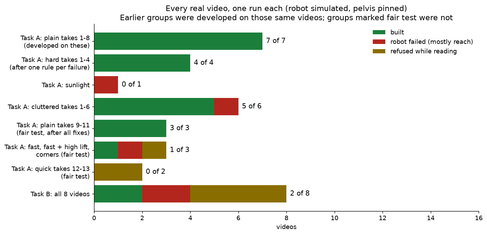
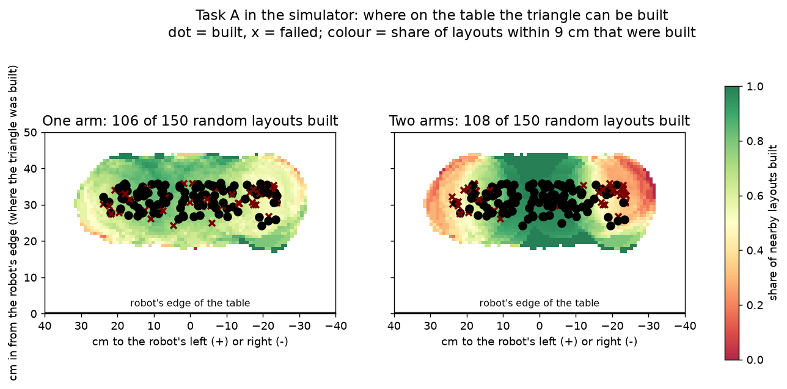
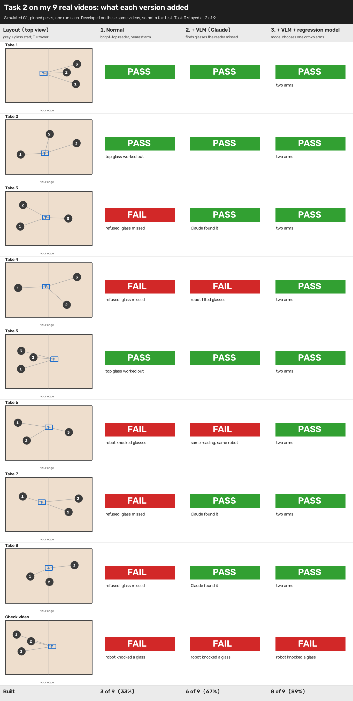
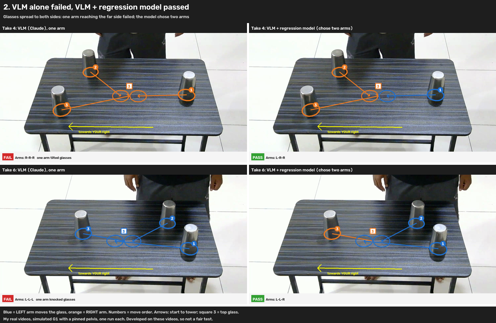
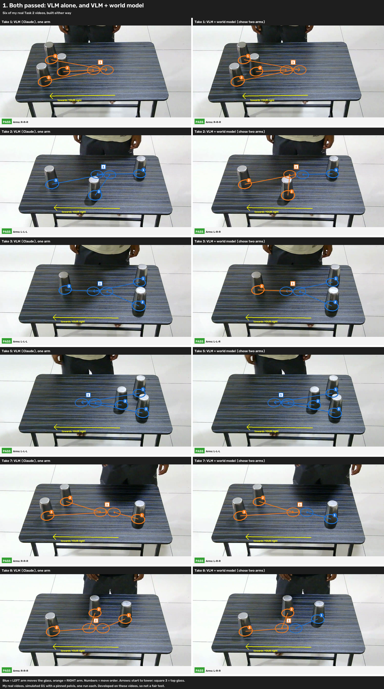
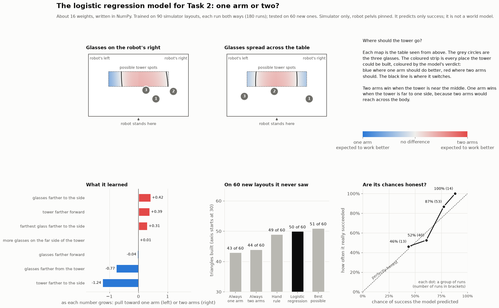
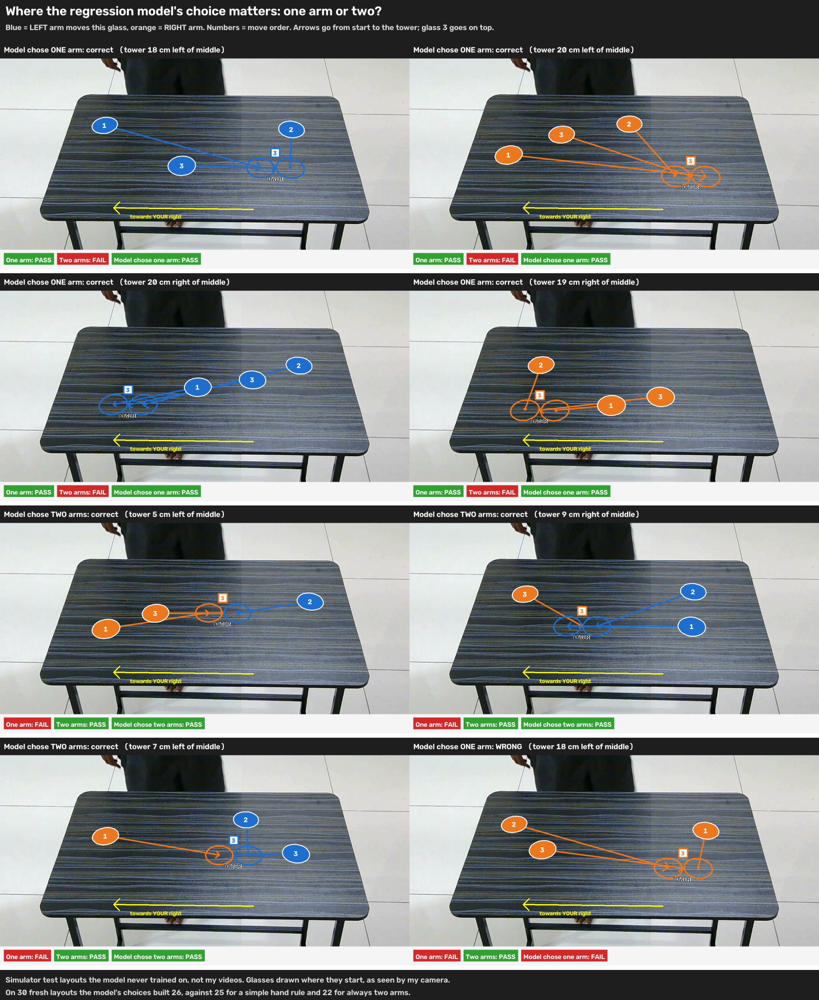
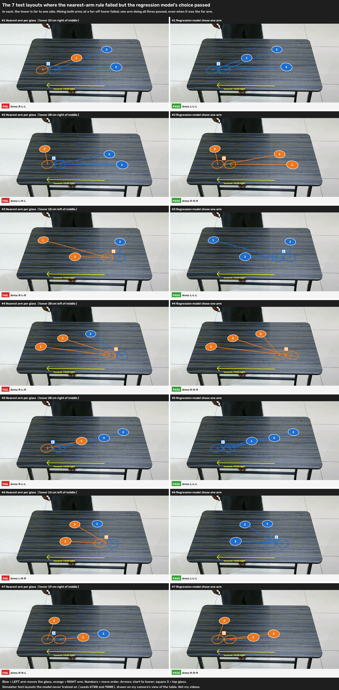
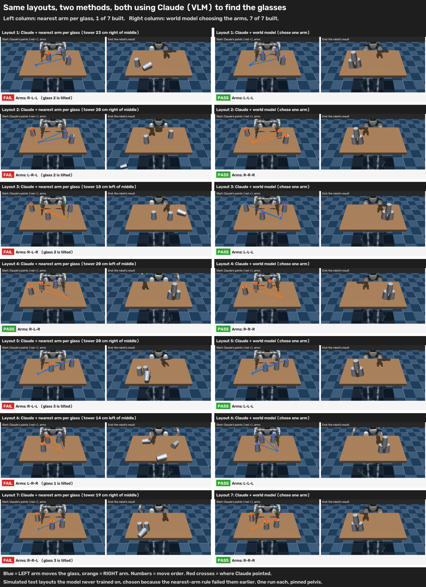

# Analysis: where it works, where it fails, and what each part adds

Every chart here comes from saved runs in [`results/`](results/). The robot is always simulated in MuJoCo with its pelvis pinned (it can't fall, and it can't walk). Each real video was run once.

**Contents**
1. [Every real video](#1-every-real-video)
2. [Where on the table Task A works](#2-where-on-the-table-task-a-works)
3. [What Claude and the logistic regression model each add](#3-what-claude-and-the-logistic-regression-model-each-add)
4. [The logistic regression model: one arm or two](#4-the-logistic-regression-model-one-arm-or-two)
5. [Where the arm choice matters](#5-where-the-arm-choice-matters)
6. [What the failures have in common](#6-what-the-failures-have-in-common)

---

## 1. Every real video

| Group | Built | What to know |
|---|---|---|
| Task A, plain takes 1–8 | 7 of 7 | Developed on these videos, so not a fair test |
| Task A, hard takes 1–4 | 4 of 4 | First run was 0 of 4; one rule was added per failure |
| Task A, sunlight | 0 of 1 | Triangle built too close to the robot's chest |
| Task A, cluttered takes 1–6 | 5 of 6 | Takes 4–6 were a fair test of the clutter rules: all read correctly; take 4 failed (triangle against the robot's chest) |
| Task A, plain takes 9–11 | **3 of 3** | **Fair test:** recorded after every fix, camera moved, nothing changed |
| Task A, fast / fast + high lift / corners | **1 of 3** | **Fair test.** Fast with a low lift built; a high lift at 4× speed was refused (two rests too short to see); corners were out of reach |
| Task A, quick takes 12–13 | **0 of 2** | **Fair test.** Quick moves confused the timing: both refused |
| Task B, all 8 videos | 2 of 8 | Most glasses are beyond a robot that can't walk |

**Task A in total: 20 of 26 videos kept** (20 of 30 counting 4 deleted as out of the robot's reach). **On fair tests only** (cluttered takes 4–6 and everything recorded after the last fix): **6 of 11**. Both numbers matter: the system works on videos like the ones it was built on, and new kinds of video (very fast moves, glasses at the corners, triangles near the robot's chest) still find its limits.

---

## 2. Where on the table Task A works

150 random simulator layouts for each choice. Each dot is where the triangle was built: black = built, red x = failed. The colour is the share of layouts within 9 cm that were built.

- **Two arms are best in the middle** (dark green): each glass is taken by the arm on its side, so no arm reaches across the body.
- **Far to either side, two arms do worse** (red): the arm swap happens far from the body.
- **One arm is steadier but never as good in the middle.** Overall: one arm 106 of 150, two arms 108 of 150.
- **No layout was tested closer than about 24 cm to the robot's edge.** Every real failure from a triangle near the person's edge (sunlight, clutter take 4, and the deleted take 14) sits in that untested strip. That's the clearest next step.

---

## 3. What Claude and the logistic regression model each add

On the first 9 real videos: the CV reader alone built **3 of 9**; adding Claude to find glasses the reader missed made it **6 of 9**; adding the model to choose one arm or two made it **8 of 9**. These are the videos the system was developed on, so this shows what each part adds, not how well it does on new videos.

| Where Claude alone failed and the model fixed it | Where both worked |
|---|---|
|  |  |

---

## 4. The logistic regression model: one arm or two

A 16-weight logistic regression model, trained on saved simulator runs, predicts the chance of success with one arm and with two. Left: the shaded table shows where it expects each to work. Middle: on 60 layouts it never saw, its choices built **50**, against 43 for always one arm, 44 for always two, 49 for a hand-written rule, and 51 for the best possible choice. Right: when it says 70%, about 70% of those layouts built.

Since 5 Nov, two arms win near ties: one arm is used only if its predicted chance is more than 10 points higher (`two_arms_margin` in `configs/cups_real.yaml`). On take 14 that changed the choice from one arm to two; it still failed, but the tower was 2 cm off instead of 30.

---

## 5. Where the arm choice matters

Simulator layouts drawn on my camera's view, where one choice built the triangle and the other didn't. Blue = left arm, orange = right arm, numbers = move order.

| The simple nearest-arm rule failed; the model's choice passed | Claude + simple rule against Claude + model |
|---|---|
|  |  |

---

## 6. What the failures have in common

| Cause | Videos | Fix it would need |
|---|---|---|
| Triangle built against the robot's chest | Sunlight, clutter take 4 (and take 14, later deleted) | Let the robot step back, or test and tune that strip of the table |
| A glass carried from one far side to the other, close to the robot's body | Takes 14 and 15 (later deleted as out of reach): a glass starting at one far side is carried across to the triangle near the robot's chest, so the arm crosses the body at close range | Two arms helped (tower 30 → 2 cm off) but not enough; build the triangle further in |
| Glasses beyond reach | Task B takes 2, 3; Task A corners | Let the robot walk or step to the side |
| Moves too quick to time | Fast + high lift, takes 12, 13 | Accept short pauses, or use Claude's start and end positions when the timing is impossible |
| A starting glass missed | Task B takes 4, 5, 8, clutter 3 | Better reading for the flip |

The reading of what moved where is right far more often than the robot's ability to repeat it: most failures are the robot's reach, not its eyes.
