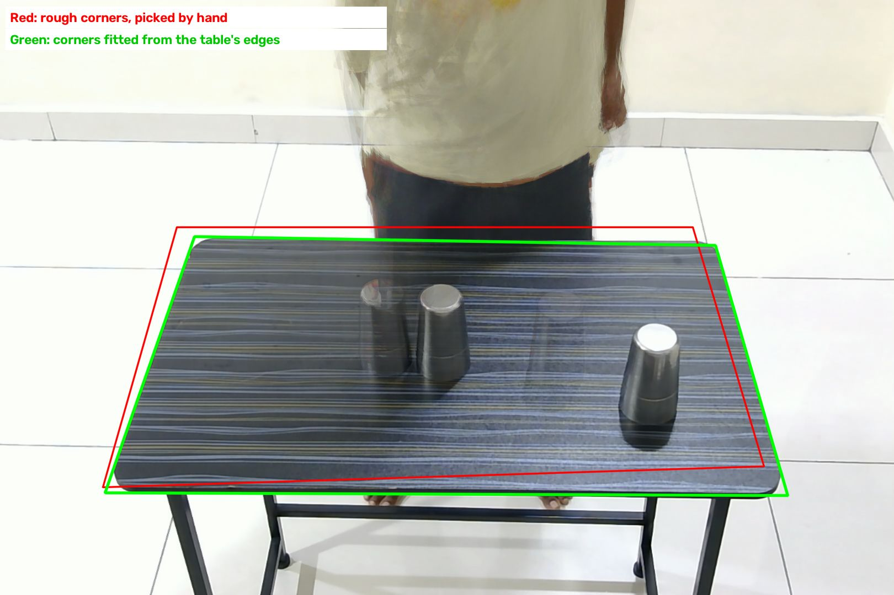
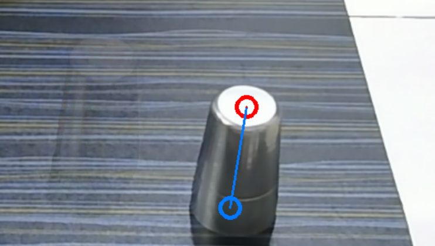
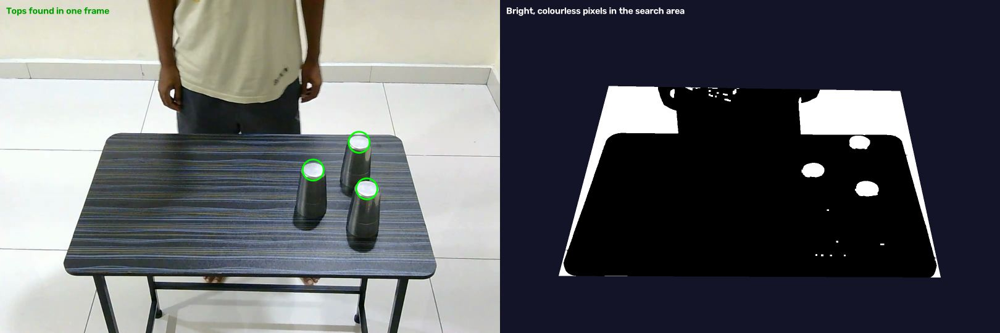
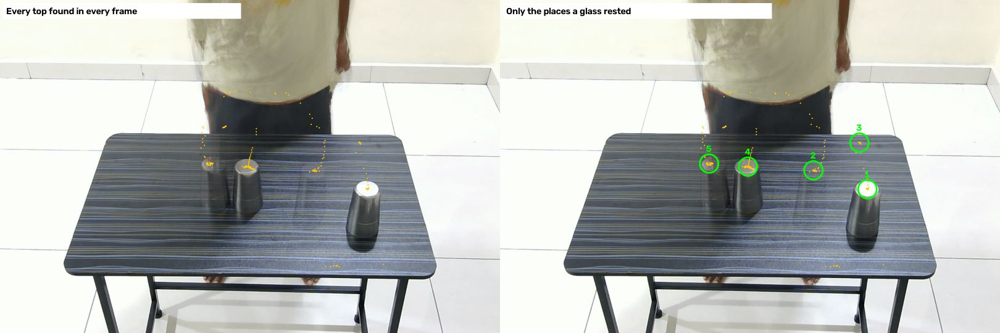
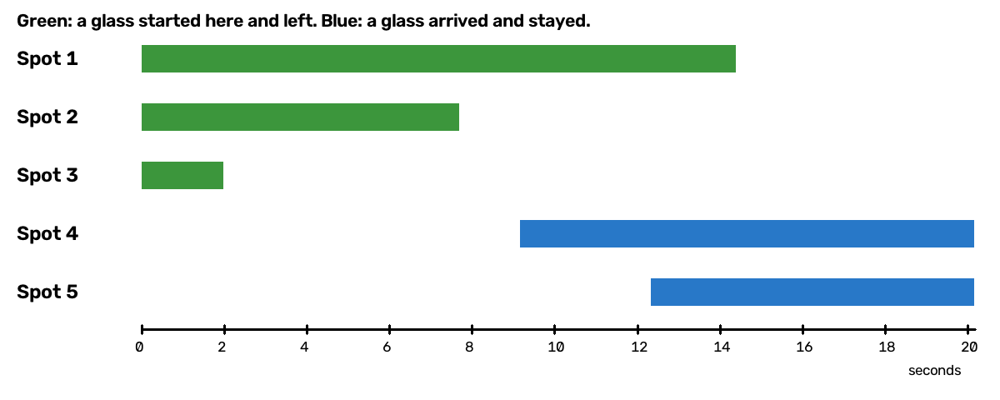
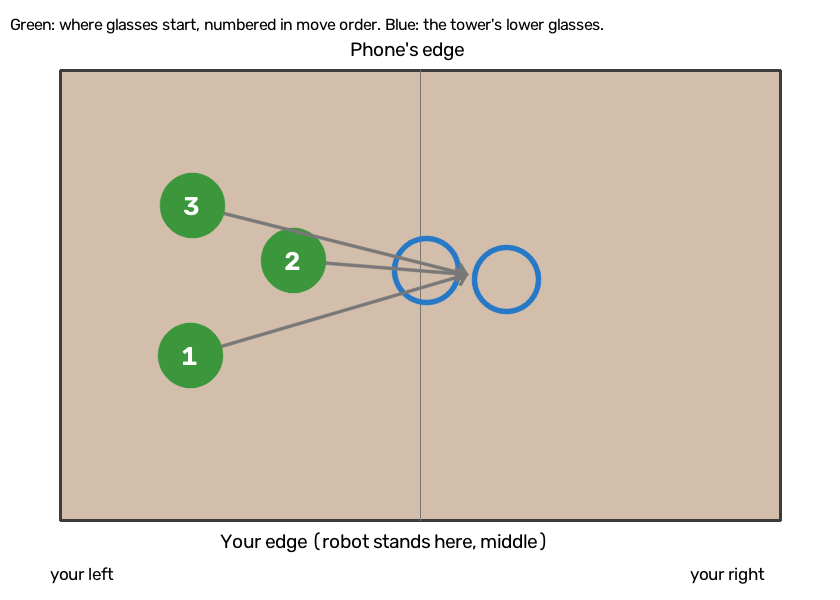
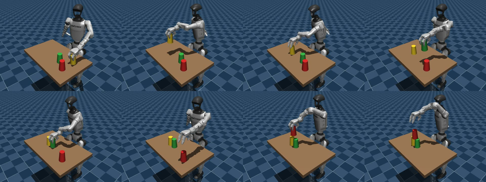

# How the project works, from video to robot

This follows one real video, `task2_triangle_take5`, through every step. Every number below comes from running the code on that video.

## Contents

1. [The whole pipeline on one page](#1-the-whole-pipeline-on-one-page)
2. [Step by step](#2-step-by-step)
3. [What changes for Task 3](#3-what-changes-for-task-3)
4. [What comes from your video, and what is programmed](#4-what-comes-from-your-video-and-what-is-programmed)
5. [Where it fails, and how far to trust it](#5-where-it-fails-and-how-far-to-trust-it)
6. [Code that this pipeline doesn't use](#6-code-that-this-pipeline-doesnt-use)
7. [Run it yourself](#7-run-it-yourself)
8. [Glossary](#8-glossary)

---

## 1. The whole pipeline on one page

```
 YOUR VIDEO
     |
     |   UNDERSTAND THE CAMERA
     v
 Step 1  Rough table corners, picked by hand once
 Step 2  Exact corners, fitted from the table's edges
 Step 3  Where the camera is, from the corners and the table's real size
 Step 4  A way to turn any pixel into a real table position
     |
     |   READ WHAT YOU DID
     v
 Step 5  Find bright round glass tops in every frame
 Step 6  Group them into the places where a glass rested
 Step 7  Read the task: which glass moved when, and where the tower is
     |
     |   PLAN FOR THE ROBOT
     v
 Step 8  Turn table positions into positions from the robot
 Step 9  Choose the arm (and, in Task 3, the standing spot)
     |
     |   ACT AND CHECK
     v
 Step 10 Build the simulated world, with glasses where the video had them
 Step 11 The robot picks, carries, levels, aims, lowers and lets go
 Step 12 Judge the result from where the glasses end up
 Step 13 Save the report and the videos
```

### Your guess, compared with what's really built

You guessed: video, frames, a VLM that extracts features, a planner, then 3D coordinates. The overall shape is right, but some parts differ:

| What you guessed | What's really built |
|---|---|
| Extract frames from the video | Yes, but **every frame** is read. It doesn't choose a few key frames |
| Feed the video to a VLM | **No VLM or other AI model runs anywhere in this pipeline.** It uses classic image processing, with hand-written rules and measurements |
| The VLM extracts features | The one "feature" is a **bright, round, colourless patch**, which is the closed top of a steel glass |
| A planner decides what to do | **A few rules, not a model.** They read the order from the times glasses left their spots, and choose an arm from an average |
| Estimate 3D coordinates | **Yes, partly.** It finds the camera's position in 3D, and uses the glass's known height to place each glass on the table. It only works out positions on the table, not full 3D shapes |
| The robot follows the plan | **Yes, in the MuJoCo simulator.** Its grip and movements are programmed. It didn't learn them from your video |

So there's no training and no API key in this pipeline. The video decides *what* to do and *where*. Hand-written code decides *how* the robot does it.

---

## 2. Step by step

### Step 0: Record the video

**What you did.** You stood behind the table with a fixed camera facing you, and moved three steel glasses into a triangle.

| Input | Output |
|---|---|
| You, a table and three glasses | `data/raw/task2_triangle_take5.mov` |

The video is 605 frames, 20.2 seconds at 30 frames per second, and each frame is 1620 x 1080 pixels.

A **pixel** is one dot of a picture, named by its column and row. Pixel (1190, 614) is 1190 dots from the left and 614 dots from the top. A **frame** is one picture in the video.

The steps below all use the same two measurements of your real objects, which are written in `configs/cups_real.yaml`:

- Table: 80 x 50 cm
- Glass height: 11.5 cm

---

### Step 1: Rough table corners, picked by hand

**Why.** The computer needs to know where the table is, and it can't yet find that alone. So I picked four rough corners by hand, once for this camera setup.

| Input | Output |
|---|---|
| A look at one frame | Four pixels, in `data/labels/current_setup_table.json` |

```
(320, 412)   (1255, 412)   (1384, 846)   (186, 884)
```

They don't need to be exact, as the next step corrects them. Every video from the same camera setup shares them.

**This is the one manual step in the pipeline.** Your camera moved slightly after take 1, which is why the red outline in the next picture doesn't fit well.

---

### Step 2: Exact corners, fitted from the table's edges

**Why.** A small error in the corners becomes an error in every position. The table's real corners are also rounded, so there's no sharp point to pick.

| Input | Output |
|---|---|
| The video and the rough corners | Four exact corners |

**How it works** (`_background` and `refine_corners`):

1. **Remove most of the moving person.** It takes 40 frames from across the video and, for each pixel, keeps the middle value. Anything that was there only briefly mostly disappears.
2. **Look near each rough edge.** At 120 places along each edge, it looks 30 pixels each way for the strongest change from bright to dark.
3. **Fit a straight line through those points.** It ignores points that don't fit, such as where a glass or your body covers the edge.
4. **Find where the lines cross.** Those four crossings are the corners.

```
(352.8, 429.1)   (1296.7, 445.9)   (1427.4, 899.5)   (190.6, 894.0)
```



Red is the hand-picked outline, and green is the fitted one. The faint glasses are in the blended picture because they stood in those places for part of the video.

---

### Step 3: Where the camera is

**Why.** If the computer knows where the camera is and how it's pointing, it can work out where a pixel really is on the table.

| Input | Output |
|---|---|
| Four corners, and the table's real size of 80 x 50 cm | The camera's position, direction and lens |

**How it works** (`table_view`):

The table is a rectangle in real life, but it looks like a trapezium in the picture, because its far side is further from the camera. That change of shape reveals where the camera must be, in three stages:

1. **Homography.** It finds the 3 x 3 grid of numbers that maps the flat table to the picture, using `cv2.findHomography`.
2. **Focal length.** From that grid it works out how zoomed-in the lens is, assuming square pixels and that the lens centre is the picture's centre.
3. **Camera pose.** `cv2.solvePnP` gives the camera's rotation and position from the four corners.

**Result for this video:**

| Value | Result |
|---|---|
| Focal length | 1932.5 pixels |
| Camera, forward from your edge | 1.318 m (so about 82 cm beyond the table's phone-side edge) |
| Camera, along your edge from the corner at your right | 0.425 m (close to the middle) |
| Camera, above the table | 0.973 m |

**Why no marker is needed.** A printed marker is the usual way to do this. Here, the table itself is the marker, because its size is known. That's one of the project's main ideas.

**A check.** Putting the corners back through this camera model misses by 5.3 pixels on average on this video, against about 1 pixel on your first videos (`task2_triangle_right_take1` and `task3_flip_right_take1`). Take 6 misses by 2.5 and take 2 by 5.2. So the fit is worse since the camera moved, probably because the rough corners from Step 1 are now out of date, and some of them are further from the table's edges than the 30 pixels searched. This could make positions on the newer takes a little less accurate. I haven't measured how much.

---

### Step 4: From a pixel to a real position

**Why.** This is the step that produces the 3D reasoning. One pixel alone can't tell you a distance: it only gives you a direction from the camera. Everything along that line shows up in that same pixel.

So we need one more fact, and that's **how high the point is**. We know the glass top is 11.5 cm above the table.

| Input | Output |
|---|---|
| A pixel, and how high that point is | Forward and sideways position on the table |

**A worked example, using the top of one glass** (`TableView.position`):

1. **The pixel:** (1190.3, 614.0).
2. **The line from the camera through that pixel:** direction (-0.752, 0.177, -0.666), meaning towards you, a little sideways, and downward.
3. **Follow that line until it reaches the known height:**

   ```
   camera position + t x direction = a point at height 0.115

   t = (0.115 - 0.973) / -0.666 = 1.288
   forward = 1.318 + 1.288 x (-0.752) = 0.35 m
   sideways = 0.425 + 1.288 x 0.177 = 0.653 m
   ```

4. **Measured from the table's middle:** 65.3 - 40 = **25.3 cm to your left**, and **35.0 cm from your edge**.

**Why the height matters so much.** If we pretended that top was on the table's surface, using a height of 0, the same pixel would give 22.0 cm from your edge. The correct answer is 35.0 cm, so ignoring the height would be 13 cm wrong, and the robot would reach for the wrong place.



The red circle is the pixel we see, at the glass's top. The blue circle is where the point directly below it really is on the table. The blue line is the glass's height as seen by the camera.

---

### Step 5: Find the glass tops in every frame

**Why.** Your glasses look identical and have no colour to follow. But each has a bright, closed top that stands out from the dark table.

| Input | Output |
|---|---|
| One frame | A list of pixels, one for each top found |

For frame 15 the output is:

```
(1189, 612)   (1014, 552)   (1164, 462)
```

**How it works** (`find_tops`), with the settings from `configs/cups_real.yaml`:

1. **Measure brightness and colourfulness.** Each pixel gets a brightness from 0 to 255, and a colourfulness (saturation) from 0 to 255.
2. **Set the brightness limit.** The table's typical brightness in this frame is 95. A pixel must beat the larger of 95 + 28 = 123 and 150, so here the limit is **150**.
3. **Keep bright, colourless pixels.** Brightness above 150 and saturation below 45.
4. **Remove specks** smaller than about 5 pixels across.
5. **Only look at the table,** plus 150 pixels above your edge of it in the picture, because glass tops near you can stick up past it.
6. **Keep patches shaped like a top:** an area of 500 to 9000 pixels, filling more than 82% of a fitted oval, and not too stretched.



On the right is what the computer works with. The floor behind your edge of the table is also bright, so tops seen against it can merge with it and get lost. Some tops also look dull, and fall below the limit. **That's the main weakness of this pipeline,** and it's a big part of why your videos were refused.

Across all 605 frames it found 1185 tops, and at least one top in 589 frames.

---

### Step 6: Group the tops into places where a glass rested

**Why.** The list from Step 5 includes carried glasses, reflections and flickers. What we want is where glasses *stood still*.

| Input | Output |
|---|---|
| The list of tops from every frame | Resting spots, each with a pixel and a time span |

**How it works** (`rest_spots`):

1. **Group nearby tops.** Tops within 16 pixels of each other count as the same spot.
2. **Keep lasting spots.** A spot must be seen for at least 1 second, with no gap over 1 second, and in at least 15% of the frames in that time. A carried glass moves on too quickly to count.
3. **Check it's possible.** If a top were really at glass height, it must be above the table. Reflections often fail this.
4. **Merge close spots.** Two spots within 30 pixels are treated as one, because two glasses can't stand that close.



On the left, each orange dot is one top found in one frame. On the right, only the resting spots are circled. The dots trailing around them are glasses being carried, and they're correctly ignored.

**Result for this video:**

| Spot | Pixel | Seen from | Until | Forward from your edge | Sideways from middle |
|---|---|---|---|---|---|
| 1 | (1190, 614) | 0.0 s | 14.4 s | 35.0 cm | 25.3 cm left |
| 2 | (1015, 553) | 0.0 s | 7.7 s | 28.8 cm | 14.0 cm left |
| 3 | (1164, 462) | 0.0 s | 2.0 s | 18.2 cm | 25.5 cm left |
| 4 | (803, 541) | 9.2 s | 20.1 s | 27.8 cm | 0.7 cm right |
| 5 | (677, 531) | 12.3 s | 20.1 s | 26.8 cm | 9.6 cm right |



Reading the chart, you can see the story: glasses leave spots 3, 2 and 1 in that order, while spots 4 and 5 fill up and stay filled.

Notice that a sixth spot is missing. A full triangle should show 6: three starts, two lower glasses and the top glass. Step 7 deals with that.

---

### Step 7: Read the task

**Why.** This is the closest thing to a "planner", and it's what turns spots into a meaning: which glass moved first, and where the tower is.

| Input | Output |
|---|---|
| Resting spots | Starts in move order, the tower's middle, and whether it's a flip |

**The idea.** The glasses are identical, so they can't be told apart by how they look. They're told apart by *where they stood*. A move is one spot being left, and a new spot appearing.

**How it works** (`read_triangle`), based on how many spots there are:

- **6 spots, the normal case.** The first 3 to appear are starts, and the last 3 are ends. The third end must be the top glass, within 3 cm of the middle of the lower two, or the video is refused as "not a triangle".
- **5 spots, as in this video** (`_read_with_top_unseen`). It works out the top glass by logic, if all of these are true:
  - Three spots were left before the end of the video.
  - Two spots stayed until the end, and they're within 12 cm of each other.
  - No spot is sitting above those two.

  If so, the third glass must be on top. Otherwise, the video is refused.
- **7 spots.** It's read as a flip. See [Task 3](#3-what-changes-for-task-3).
- **Any other number.** It's refused, and the robot doesn't run. Refusing is better than running on a wrong reading.

**Result for this video:**

| Move | Glass left | At second | From your edge | Sideways |
|---|---|---|---|---|
| 1st | Spot 3 | 2.0 | 18.2 cm | 25.5 cm left |
| 2nd | Spot 2 | 7.7 | 28.8 cm | 14.0 cm left |
| 3rd | Spot 1 | 14.4 | 35.0 cm | 25.3 cm left |

- **Tower's middle:** halfway between spots 4 and 5, so 27.3 cm from your edge and 5.2 cm to your right.
- **Top glass:** not seen.
- **Spacing of the lower two as read:** 8.9 cm. They were touching, so it should be close to the rim width of 7.3 cm. That difference of about 1.6 cm shows how accurate the reading really is.



---

### Step 8: From table positions to positions from the robot

**Why.** So far, positions are measured from a corner of the table. The robot needs them measured from itself.

| Input | Output |
|---|---|
| Table positions | Simulator positions, in metres from the robot's pelvis |

In the simulator, **x** points forward from the robot and **y** points to its left. The table's near edge is 16 cm in front of the robot, and its middle is straight ahead. So (`_to_robot`):

```
x = forward + 0.16
y = sideways from the corner - 0.40
```

| Item | Table position (forward, sideways from corner) | Robot position (x, y) |
|---|---|---|
| Glass 1 | (0.182, 0.655) | (0.342, 0.255) |
| Glass 2 | (0.288, 0.540) | (0.448, 0.140) |
| Glass 3 | (0.350, 0.653) | (0.510, 0.253) |
| Tower middle | (0.273, 0.348) | (0.433, -0.052) |

The robot stands where you stood, facing the same way, so its left is your left.

---

### Step 9: Choose the arm

| Input | Output |
|---|---|
| Starts and tower | Which arm, and the target for each glass |

**How it works** (`nearest_arm`): it averages the sideways position of the three glasses and the tower.

```
(0.255 + 0.140 + 0.253 - 0.052) / 4 = +0.149
```

That's positive, so most of the work is on the robot's left, and it uses its **left arm** for the whole task.

**Target positions** (`triangle_targets`) are then worked out from the tower's middle:

| Glass | x | y | Height above the floor |
|---|---|---|---|
| 1st, lower | 0.433 | -0.091 | 0.7775 m |
| 2nd, lower | 0.433 | -0.013 | 0.7775 m |
| 3rd, on top | 0.433 | -0.052 | 0.8925 m |

- **The spacing is fixed at 7.8 cm.** The robot doesn't copy the 8.9 cm it read, as that's just reading error.
- **The arm's far side fills first,** so the hand doesn't pass over a glass it has already placed.

**There's no plan file here.** The "plan" is just these starts, this order, this tower and this arm, held in memory.

---

### Step 10: Build the simulated world

| Input | Output |
|---|---|
| Glass positions, tower and arm | A MuJoCo world with the robot, the table and the glasses |

**What's in it** (`build_model` in `src/simulation/scene.py`):

- **Robot:** Unitree G1 with hands, from the MuJoCo Menagerie collection of robot models, with 43 motors. Its **pelvis is pinned** in place, so it can't fall over or walk.
- **Table:** 80 x 50 cm, with its top 72 cm above the floor.
- **Glasses:** your measured shape, 11.5 cm tall, 7.3 cm rim and 5.5 cm closed end. They're solid and rigid, and the weight of 60 g is a guess.
- **Colours:** yellow, green and red in the simulator, only so you can tell them apart.

**This is where your video's data enters the robot's world.** Each glass starts at the position read from your video.

---

### Step 11: The robot acts

| Input | Output |
|---|---|
| The world and the targets | Robot movement, physics, and a video |



**What it does for each glass** (`build_glass_triangle`):

**Pick** (`pick`):
1. Open the fingers.
2. Move the hand to 24 cm above the table, over the glass.
3. Come down slowly to 6 cm above the table, at 10 cm per second.
4. Close the fingers, with limited force, and wait 0.6 seconds.
5. Lift. Then check it's really held: the glass must have risen at least 5 cm and be within 6 cm of the hand.

The glass is held only by friction. It isn't stuck to the hand, so it can slip or drop.

**Place** (`place_glass`):
1. Carry the glass over the target.
2. **Level:** measure how far the glass leans, and turn the hand to straighten it.
3. **Aim:** measure the error, and nudge the hand until it's within 1 mm of the target, up to 3 tries.
4. Lower slowly, at 4 cm per second.
5. Aim again.
6. Relax the fingers gently, so the stored squeeze doesn't knock the glass.
7. Open them, and lift the hand 16 cm straight up.

For the top glass, the target comes from where the two lower glasses **actually are**, not where they were planned.

**How "move the hand there" becomes physics.** There are four layers, each turning the request into something more basic (`RobotEnv.move_hand`):

1. **Smooth path.** The hand's straight-line route is split into small waypoints using a **minimum-jerk** curve, which starts and stops gently. Halfway through the time it's halfway along, and at a quarter of the time it has only gone 10.4% of the way.
2. **Inverse kinematics** (`ArmIK.solve`, using the mink library). For each waypoint: "the hand must be here, at this angle, so what must each joint angle be?" It moves one arm and the waist's lean, and holds the other joints still. The waist's twist is set first, so the shoulder faces the target.
3. **Motor targets.** The joint angles are sent to the motors 25 times a second, with extra force added to cancel gravity.
4. **Physics.** MuJoCo works out forces, contact and friction 500 times a second. That's what really moves the arm and glass.

**A key limitation: the robot has no camera.** When it "measures" a glass, it reads that glass's exact position directly from the simulator. Your video only sets where the glasses start.

---

### Step 12: Judge the result

**Why.** It would be easy to report success because the robot finished its motions. So the check looks only at where the glasses end up.

| Input | Output |
|---|---|
| Final positions and angles of the glasses | Success, or a list of what's wrong |

**The rules** (`triangle_failures`):

| Check | Limit |
|---|---|
| Each glass isn't tilted | Up to 10 degrees |
| Lower glasses are standing on the table | Height within 1.5 cm |
| Lower glasses are side by side | Spacing of 7.8 cm, within 2 cm |
| Top glass rests on the lower two | Height within 1.5 cm |
| Top glass is centred over them | Within 2 cm |

These are the same words you've seen in failures, such as `top cup is tilted`.

---

### Step 13: Save the report and videos

The final report for this video:

```json
{
  "video": "task2_triangle_take5.mov",
  "task": "triangle",
  "moved_at_seconds": [2.0, 7.7, 14.4],
  "starts_from_video": [[0.342, 0.255], [0.448, 0.14], [0.51, 0.253]],
  "tower_from_video": [0.433, -0.052],
  "lower_spacing_in_video_cm": 8.9,
  "top_glass_seen_in_video": false,
  "top_glass_offset_in_video_cm": null,
  "arm": "left",
  "success": true,
  "failures": [],
  "robot_tower_error_cm": 0.4
}
```

`robot_tower_error_cm` means the robot built the tower 0.4 cm from where the video put it.

**Files saved:**

| File | What it is |
|---|---|
| `data/processed/task2_triangle_take5/report.json` | The report above |
| `data/processed/task2_triangle_take5/robot.mp4` | The robot's run, 86 seconds |
| `docs/videos/task2_left_arm_video_to_robot.mp4` | You and the robot side by side, with the robot sped up 4.3 times |

---

## 3. What changes for Task 3

Task 3 adds a fourth glass, which the robot must flip and put on top with its opening facing up. Here's what's different, using `task3_flip_right_take1`.

**Reading the video (Step 7).** The flipped glass adds a start, but no end, because its opening is dark and shows no bright top. So a flip shows **7 spots**: 4 starts and 3 ends (`read_flip`).

**Checking for the flip** (`opening_faces_up`). It looks at the spot where a fourth glass's opening should be, three glass-heights above the table, in the video's last frames. It must be dark, with a brightness under 110. A closed top there would be bright, and an empty space would show the bright floor or wall.

**Choosing the arm and standing spot (Step 9)** (`plan_stand`). The flip only worked with the tower about 28.5 cm to one side of the robot.
- If the tower is to the left of the glasses, it uses the left arm. Otherwise, it uses the right.
- The robot stands so the tower is 28.5 cm to that arm's side.
- For this video: **left arm, 23.4 cm to the right of the table's middle.**

**The robot doesn't walk there.** The simulation simply starts it at that spot. In the code, the table and glasses are shifted instead (`center_y`), which amounts to the same thing.

**The robot's actions (Step 11).** The triangle is built as usual. Then (`build_flipped_tower`):

1. **Side grip** (`grip_from_side`). The palm comes beside the glass, not above it, because the hand can't end up underneath.
2. **Twist** (`twist_over`). The arm moves to a set pose, then only the wrist turns, by 3.14 radians (half a turn) over 5 seconds. Solving this with inverse kinematics swung the whole arm violently and threw the glass.
3. **Level** the glass again (`level_cup`).
4. **Place it** (`place_flipped`) on the top glass's measured position, allowing for the small drift when the fingers open.
5. **Back away sideways, then lift,** because a flipped glass is widest at the top and lifting straight up would catch its rim.

**The check (Step 12)** adds the fourth glass's rules (`flip_failures`), as well as the triangle's.

**Result for this video:** success, tower within 0.5 cm, no glass moved.

---

## 4. What comes from your video, and what is programmed

This matters for the challenge's rule that your recorded data has to play a real role.

| Comes from your video | Programmed by hand | Given by you, measured or hand-picked |
|---|---|---|
| Where each glass starts | How to grip | Table size |
| The order they move in | How to carry, level and aim | Glass size |
| Where the tower goes | The flip's twist | Rough table corners |
| Whether a flip happened | How fingers open and lift away | |
| So also: which arm, and in Task 3, where the robot stands | What counts as success | |

The robot didn't learn its movements from watching your hand. In fact, the pipeline never looks at your hand. A different layout in your video produces a different robot run, but the way it grips is always the same.

---

## 5. Where it fails, and how far to trust it

**Results on your later Task 2 videos:**

| Videos | Result |
|---|---|
| Takes 2 and 5 | Succeeded, left arm, tower 0.4 cm off. Top glass not seen, so it was worked out |
| Check video and take 6 | Read correctly, but the robot failed. It knocked over glasses in the simulator |
| Takes 3, 4, 7 and 8 | Refused, because a starting glass was missed |

Before I added the rule for an unseen top glass, 0 of these 8 succeeded. After it, 2 of 8 did. I wrote that rule after seeing these videos, so **they aren't a fair test of it.**

**Other limits to be honest about:**

- **Each success is one run** of one video. The simulator tests are the better guide to reliability: 28 of 30 on the tested areas, and 24 of 30 on left-side layouts.
- **No ruler check.** I have no real measurements of where the glasses were, so reading accuracy is only checked indirectly. The lower spacing of 8.9 cm against 7.3 cm suggests errors of a centimetre or two.
- **Pinned pelvis, no walking.** The robot can't fall, and it doesn't balance.
- **The robot has no camera,** and it reads exact positions from the simulator.
- **Glasses are simplified:** solid, rigid and a guessed weight.
- **The table's corners fit less well on the newer takes,** as explained in [Step 3](#step-3-where-the-camera-is).
- **Compression changes the reading.** The compressed sample copy of this video, `data/raw/sample/task2_triangle_take5.mp4`, did see the top glass, 1.1 cm off, and read the second move at 7.2 s instead of 7.7 s. The robot's result was the same. This shows the reader is sensitive to small changes in the picture.
- **A risk in the new rule.** A Task 3 video that loses two spots could look like 5 spots, and be read as Task 2. Check the `task` line in the report.

---

## 6. Code that this pipeline doesn't use

The project has earlier code for sorting coloured blocks, which has never been run on real footage. It's closer to what you pictured:

| Earlier code | What it does | Why it isn't used here |
|---|---|---|
| `src/keyframe_selector/` | Follows your hand with MediaPipe, an AI hand tracker, and finds key moments | Glasses are read from where they rest, so the hand isn't needed |
| `src/perception/color_tracker.py` | Follows objects by colour | Steel glasses have no colour |
| `src/perception/observe_video.py` | Uses a printed marker to get real positions | The table now does this job |
| `src/schemas/plan.py` | A plan written as a file | The glass tasks don't need one |

**Where AI could fit later.** None of this is built:

- **A vision model such as SAM 2** could follow glasses better than bright tops, which would fix the main weakness in Step 5.
- **A VLM** could say what task a video shows, instead of counting spots.
- **Learning the movement,** from your hand or from simulation, would be a big step up, and is the optional last stage in `PLAN.md`.

---

## 7. Run it yourself

```bash
# Read a video and run the robot: writes report.json and robot.mp4
PYTHONPATH=. .venv/bin/python scripts/glass_from_video.py --video data/raw/task2_triangle_take5.mov

# Put the video and robot side by side
PYTHONPATH=. .venv/bin/python scripts/side_by_side.py --video data/raw/task2_triangle_take5.mov

# Run the same thing for Task 3
PYTHONPATH=. .venv/bin/python scripts/glass_from_video.py --video data/raw/task3_flip_right_take1.mov

# Watch the task live in MuJoCo
PYTHONPATH=. .venv/bin/mjpython scripts/watch_live.py

# Run all tests
.venv/bin/pytest
```

**Where each step lives:**

| Steps | File |
|---|---|
| Runs everything in order | `scripts/glass_from_video.py` |
| 2, 3, 4 | `src/perception/table_view.py` |
| 5, 6, 7 | `src/perception/glass_tracker.py` |
| 9 | `src/reasoning/fit_layout.py` |
| 10 | `src/simulation/scene.py` |
| 11 | `src/simulation/glass_task.py`, `primitives.py`, `robot_env.py`, `ik.py` |
| 11, for the flip | `src/simulation/cup_flip.py` |
| 12 | `src/verification/triangle.py` |
| All settings | `configs/cups_real.yaml`, `configs/flip_real.yaml` |

---

## 8. Glossary

| Term | Meaning |
|---|---|
| **Pixel** | One dot of a picture |
| **Frame** | One picture in a video |
| **VLM** | Vision language model, an AI that takes pictures and answers in words. Not used here |
| **Homography** | A 3 x 3 grid of numbers that maps a flat surface to how it looks in a picture |
| **Focal length** | How zoomed-in a lens is, measured here in pixels |
| **solvePnP** | An OpenCV function that finds the camera's position from known points and where they appear in the picture |
| **OpenCV** | A popular library for working with images and video |
| **Saturation** | How colourful a pixel is. Steel and white are low |
| **Resting spot** | A place where a glass top stayed still for at least 1 second |
| **MuJoCo** | The physics simulator that the robot runs in |
| **Pinned pelvis** | The robot's hips are fixed in space, so it can't fall or walk |
| **Inverse kinematics (IK)** | Working out the joint angles that put the hand at a chosen place |
| **mink** | The library used here to solve inverse kinematics |
| **Minimum jerk** | A smooth motion curve that starts and stops gently |
| **Friction grasp** | Holding an object by squeezing it, so it can really slip |
| **Radian** | A measure of angle. 3.14 radians is half a turn |
